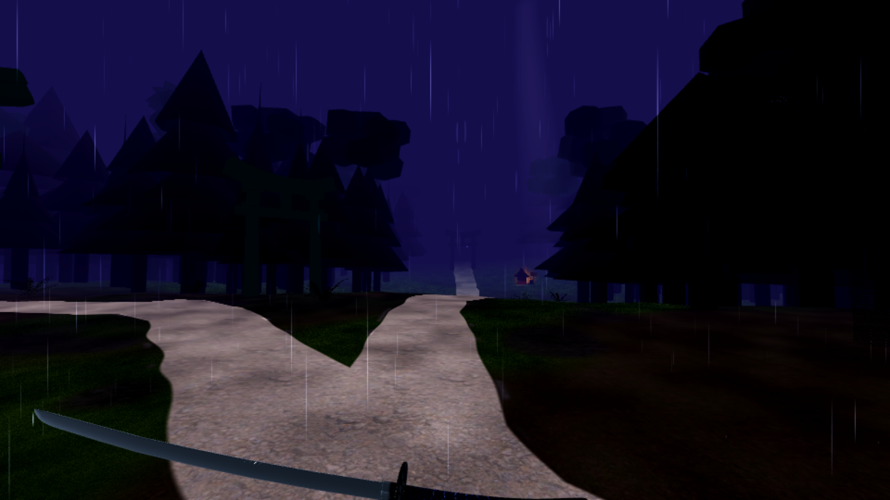
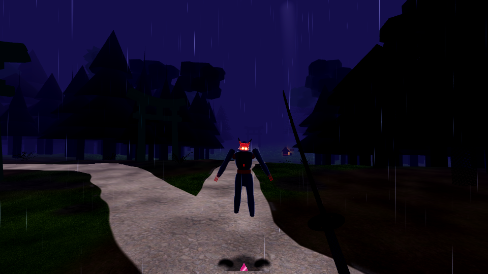

# HANABI (花火)

**A physics-katana VR survivor-like.** Cut your way through an endless, foggy yōkai forest on the night of a village matsuri. The sword has real weight, and a clean cut splits enemies along the blade. Every few minutes a masked Oni swordsman steps out of the fog. His tactics and taunts come from Meta's **Muse Spark** model, which reads how you fight.

Built solo for the Meta Global AI Developer Hackathon 2026. Runs on Meta Quest 3 and in PCVR.

## Download and play

**PCVR (Windows):** download `HANABI-PCVR-Windows.zip` from the [latest release](https://github.com/JakubFr4czek/HANABI/releases/latest).
1. Unzip it anywhere. Keep `hanabi.exe`, `hanabi.pck` and the `.dll` in the same folder.
2. Connect your headset with Quest Link or Air Link, or use SteamVR. The Link app (or SteamVR) must be set as the active OpenXR runtime.
3. Run `hanabi.exe`.

**Quest 3 (standalone):** sideload the APK with [SideQuest](https://sidequestvr.com/setup-howto) or `adb install -r hanabi.apk`. Your headset must be in developer mode. The game then shows up in your Library under *Unknown Sources*.

**AI boss (optional):** the Oni fights on his own logic offline. If you want his tactics and taunts to come from Muse Spark, paste your own Meta API key in the game: open the menu (left controller menu button), go to the **META AI** tab and press **PASTE KEY (CLIPBOARD)**. The status changes to **ACTIVE**.

## Controls

| Input | Action |
|---|---|
| Grip near the katana | grab it (anywhere on the handle, guard or spine); grip with both hands for a two-handed hold |
| Swing your arm | cut. The edge does full damage, the flat only a little |
| Left stick / right stick | move / turn |
| A / X | skip the intro |
| B / Y | element skill |
| Hold B or Y | recenter the view |
| Thumbstick click | element ability |
| Left menu button | skill tree and settings |
| Free hand on a shrine | choose a buff, then slice the Ofuda you want |

## Requirements

- Meta Quest 3 (Quest 2 and Quest Pro should work too). For PCVR you also need a Windows 10/11 PC that can run Quest Link or SteamVR.
- Playing in a standing room-scale space is best.
- To build it yourself you need Godot 4.7.2 (standard build).

## Credits

Third-party assets and licences are listed in [CREDITS.md](CREDITS.md) and [LICENSES.md](LICENSES.md).

---
Technical details, how to build it and the tests are in [docs/TECHNICAL.md](docs/TECHNICAL.md).
