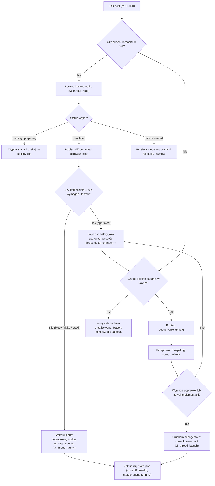

# Agent Supervision & Execution Framework
> **Standard pracy wieloagentowej w pętli autonomicznego nadzoru i rygorystycznego code review.**  
> Wersja: 1.0 (2026-10-30)  
> Zastosowanie: Projekty o wysokich wymaganiach stabilności, wydajności i jakości kodu (np. VR Quest 3, silniki gier, systemy krytyczne).

---

## 1. Architektura Systemu (Two-Tier Model)

System opiera się na separacji ról na dwa poziomy:

```
                  ┌──────────────────────────────────────────────┐
                  │          SUPERVISOR / ORCHESTRATOR           │
                  │             (Gemini Flash High)              │
                  │   - Nadzór harmonogramu (co 15 min)          │
                  │   - Trwały stan w state.json i backlogu      │
                  │   - Bezwzględne, surowe Code Review          │
                  │   - Zlecanie zadań i fallback modeli         │
                  └──────────────────────┬───────────────────────┘
                                         │
             ┌───────────────────────────┴───────────────────────────┐
             │ Przydział zadań (t3_thread_launch, czysta konwersacja)│
             ▼                                                       ▼
┌─────────────────────────┐                             ┌─────────────────────────┐
│     WORKER SUBAGENT     │                             │   FALLBACK SUBAGENTS    │
│  (Claude Haiku 5.5)     │  ───[w razie awarii]───►    │   Gemini -> Cursor      │
│ - Samodzielna praca     │                             │   -> OpenCode           │
│ - Małe commity na main  │                             └─────────────────────────┘
│ - Godot headless        │
│ - Testy przed zwrotem   │
└─────────────────────────┘
```

---

## 2. Rola Supervisora (Orchestratora)

1. **Model:** `gemini-3.8-flash-high` (`antigravity`).
2. **Cykliczność:** Pętla uruchamiana co 15 minut (reaktywny scheduler `scheduled_task` T3 / cron, bez jałowego pollingu `while(true)`).
3. **Pamięć trwała (Durable State):**
   - Ścieżka stanu: `~/.t3/userdata/<projekt>_review/state.json`.
   - Ścieżka backlogu: `~/.t3/userdata/<projekt>_review/backlog.md`.
   - W pliku `state.json` przechowywana jest kolejka zadań (`queue`), indeks bieżący (`currentIndex`), ID aktywnego wątku subagenta (`currentThreadId`), status oraz szczegółowy log decyzji (`history`).
4. **Brak wiary na słowo (Zero Trust Review):**
   - Supervisor nie polega na deklaracji agenta w czacie.
   - Po każdym commitcie / zakończeniu wątku pobierany jest `git diff` i `git log -p`.
   - Weryfikowane są asercje testowe, budżety sprzętowe i czystość architektury.
   - Wszelkie wady powodują automatyczne sformułowanie briefu poprawkowego i uruchomienie kolejnej iteracji.

---

## 3. Drabinka Wyboru i Fallbacku Modeli (Model Fallback Hierarchy)

Podczas uruchamiania wątków wykonawczych (`t3_thread_launch`) obowiązuje ścisła hierarchia fallbacku:

| Priorytet | Provider / Instance | Model | Rola / Zastosowanie |
| :---: | :--- | :--- | :--- |
| **1 (Domyślny)** | `claudeAgent` | `claude-haiku-5-5` | Główny worker implementacyjny. Szybki, zwięzły, doskonale trzymający się ograniczeń technicznych i instrukcji. |
| **2 (Fallback 1)** | `antigravity` | `gemini-3.8-flash-high` | Uruchamiany natychmiast, gdy Claude Haiku napotka błąd, rate-limit lub niedostępność. |
| **3 (Fallback 2)** | `cursor` | Modele Cursora (np. Composer / GPT-5.5) | Uruchamiany w razie awarii Gemini i Claude. |
| **4 (Fallback 3)** | `opencode` | Modele OpenCode (np. `longcat-2.5-preview-free`) | Ostateczny fallback w razie awarii wszystkich komercyjnych providerów. |

---

## 4. Zasady Obowiązujące Workera (Worker Contract)

Każdy uruchamiany agent otrzymuje w swoim pierwszym promptcie niepodważalny kontrakt zasad:

1. **Repozytorium i gałąź:**
   - Praca wyłącznie na gałęzi `main`.
   - Przed pracą: `git status` oraz `git pull --rebase`.
   - Zakaz force-push (`--force`) oraz zakaz usuwania / modyfikowania cudzych zmian bez wyraźnego polecenia.
2. **Jakość i budżety wydajnościowe (dla projektów VR/GameDev):**
   - Quest 3: $\ge 72$ fps, $\le 345$ draw calls, $\le 12$ świateł dynamicznych, $\le 28$ głosów audio.
   - Żadna zmiana nie może naruszać tych limitów (weryfikacja testami wydajnościowymi).
3. **Środowisko:**
   - Wyłącznie tryb headless (`GODOT=".tools/Godot.app/Contents/MacOS/Godot"`).
   - Zakaz uruchamiania edytorów z interfejsem graficznym (GUI).
4. **Integrity testów:**
   - **Zakaz kasowania testów** i zakaz osłabiania asercji (np. poluzowywania limitów błędów), by "wymusić" zielony wynik.
   - Pełny zestaw testów (`timeout 600 ./tools/run_tests.sh`) musi przejść na zielono przed zakończeniem turnu.
5. **Atomiczne commity:**
   - Małe commity z jasnym opisem Conventional Commits (`feat(...)`, `fix(...)`, `test(...)`, `docs(...)`).
   - Wypchnięcie zmian na zdalne repozytorium (`git push`).
6. **Meldunek końcowy:**
   - Ostatnia wiadomość workera musi zaczynać się od określonego szablonu:
     `GOTOWE: <ID_ZADANIA> | commit <hash> | testy: <X/Y pass>`  
     albo  
     `CZĘŚCIOWO: <ID_ZADANIA> | commit <hash> | testy: <X/Y pass>` (z dokładnym opisem ograniczeń).

---

## 5. Pętla Przeglądu (Algorytm Supervisora w każdym ticku 15 min)



---

## 6. Struktura Plików Konfiguracyjnych

### `state.json`
```json
{
  "queue": [
    "TASK_1",
    "TASK_2",
    "TASK_3"
  ],
  "currentIndex": 0,
  "currentTask": "TASK_1",
  "currentThreadId": "mcp:cf3290fd-55c4-46a9-a4ff-ff5359bbbc21",
  "status": "agent_running",
  "history": {
    "PREV_TASK": {
      "status": "approved",
      "reviewedAt": "2026-10-30T08:28:00+01:00",
      "notes": "Sprawdzone i przetestowane: 100% pass, budżety zachowane."
    }
  }
}
```

### `backlog.md`
Rejestr zadań o wyższym poziomie szczegółowości, zawierający:
- Nazwę i ID zadania.
- Obserwację problemu (np. z testów VR Jakuba).
- Wymagane zmiany architektoniczne i algorytmiczne.
- Kryteria akceptacji (Definition of Done) i niezbędne testy automatyczne.

---

## 7. Zalety Frameworka
- **Odporność na halucynacje:** Worker może popełnić błąd, ale Supervisor wyłapie go na poziomie surowego diffa i testów.
- **Odporność na awarie modeli:** Żaden pojedynczy provider ani model nie blokuje postępu dzięki automatycznemu fallbackowi.
- **Czystość kontekstu:** Każde zadanie to świeża konwersacja subagenta (`workspaceStrategy: root`), zapobiegająca degradacji kontekstu i gubieniu instrukcji.
- **Niezmienna historia decyzji:** Cały przebieg prac, decyzje architektoniczne i commity są utrwalone w `state.json` i w repozytorium.
