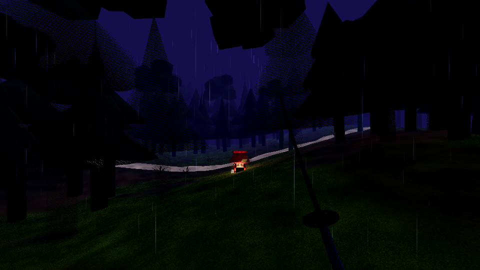
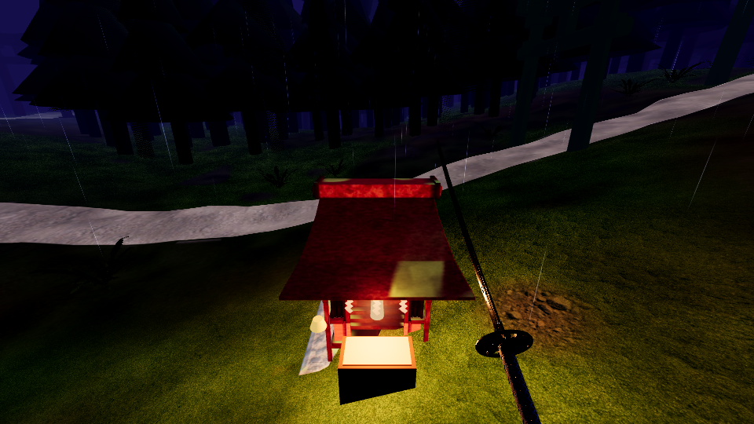
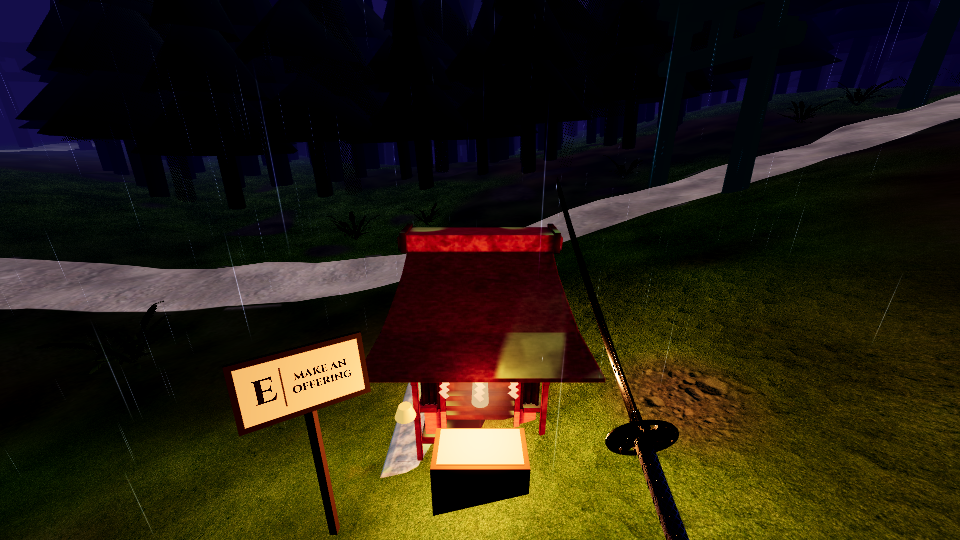
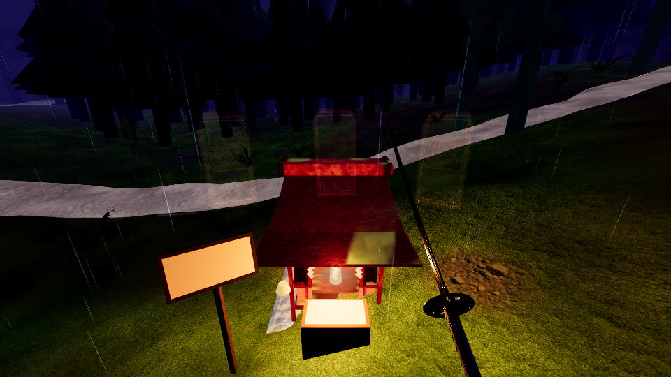
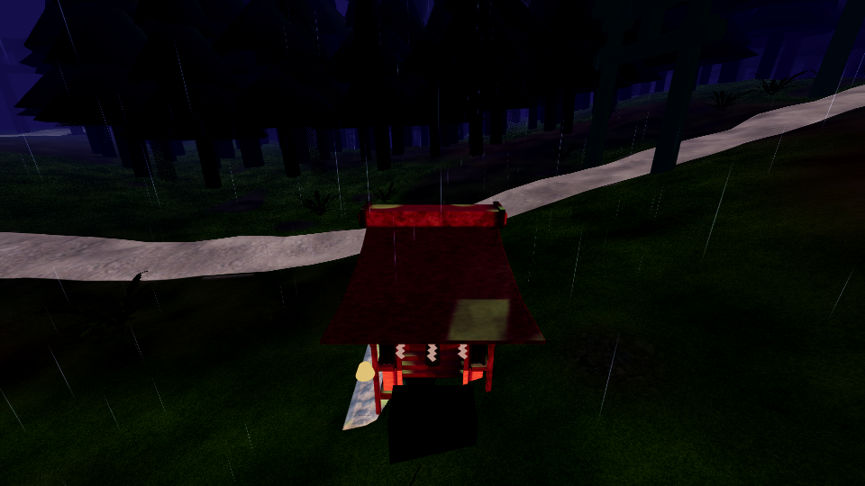
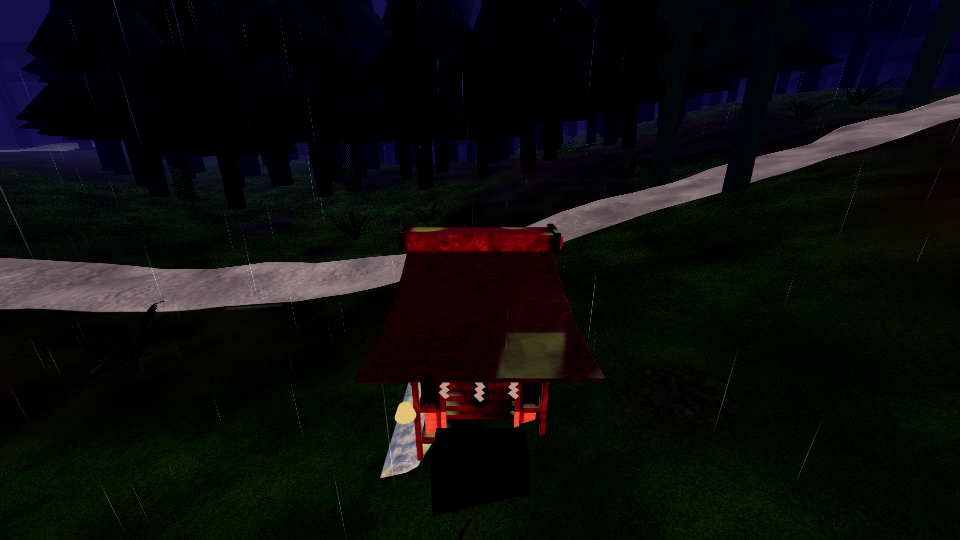

# F3 — kapliczka: oczywista aktywacja

Diagnoza i decyzje: [NOTES.md](NOTES.md).

## Co jest teraz
- Gracz ≤ `ElementBalance.HOKORA_PROMPT_RADIUS` (2.0 m, w poziomie) od ołtarza zapalonej kapliczki →
  `HokoraManager.prompt_shrine()` wybiera tę jedną kapliczkę:
  - czerwona tkanina ołtarza „oddycha" ciepłym pulsem (0.4 Hz), halo latarni +35 %,
  - papierowa tabliczka na słupku po lewej stronie ołtarza zapala się (ciepła emisja papieru, bez
    światła) i pokazuje tusz: **E │ MAKE AN OFFERING** (desktop; litera z `OS.get_keycode_string(RunGame.OFFERING_KEY)`),
    w VR: **TOUCH THE ALTAR** (dłoń na stole — A/X zostaje przy zdolności 1).
  - Tabliczka obraca się na słupku do gracza (tylko yaw), żeby dało się ją czytać z każdej strony.
- Z daleka tabliczka jest pustym, lekko ciepłym papierem (zachęta „tu coś jest"), bez tekstu.
- Aktywacja: jedno E / jeden dotyk dłonią (bez zmian w logice). Feedback: dzwonek `hokora_suzu`
  (istniejący), rozbłysk świecy (płomień ×3, światło świecy ×2.5, halo, 1.4 s, także w czasie pauzy
  wyboru), haptyka obu kontrolerów (VR), tabliczka gaśnie, potem trzy ofudy.
- Po wyborze kapliczka gaśnie na resztę przebiegu, a tabliczka znika — nie podświetla się nigdy więcej.
- Na desktopie tabliczka nie zapala się, gdy E trafiłoby w dzwon (dzwon bliżej niż ołtarz) — nie
  obiecuje czegoś, czego klawisz nie zrobi.

## Koszt
4 meshe + 2 Label3D na kapliczkę (słupek, rama, papier, kreska, 2 napisy), żadnych świateł. W
zasięgu gracza są zwykle 1–2 kapliczki.

## Testy
- `tests/hokora_test.gd` (sekcja F3): brak podpowiedzi 6 m i 2.6 m; podpowiedź na 1.5 m z klawiszem
  z bindingu; prawdziwe zdarzenie klawisza E otwiera wybór dokładnie raz, drugie wciśnięcie nic
  nie robi, cięcie daje nagrodę raz, użyta kapliczka ciemna i bez podpowiedzi, kolejne E nic.
- Okienkowo (piksele, prawdziwa scena run.tscn): na 1.5 m tabliczka cała w kadrze, papier jasny,
  kontrast tuszu ≥ 4.5 : 1, ciepła barwa.

## Zrzuty (z gry, te same kamery, `tests/f3_prompt_shots.tscn`)
| | przed | po |
|---|---|---|
| 12 m |  |  |
| 1.5 m |  |  |
| E → karty |  |  |
| po wyborze |  |  |

## Co słabe / dalej
- Tabliczka to prosta deska na słupku — czytelna i spokojna, ale nie ma japońskiego detalu
  (np. daszek kōsatsu). Rozmiar tekstu dobrany pod 960×540; na Quest jest ok. 2× ostrzejszy.
- VR nie ma przycisku: A/X jest zajęty. Jeśli F4 przeniesie interakcję na przycisk, wystarczy
  zmienić `prompt_key`/`prompt_action` w `run_game.gd` (zaraz po `hokora_manager.setup`).
- Haptyka VR nie ma testu (wymagałaby xr-sim); jest wywoływana z tego samego miejsca co otwarcie.
